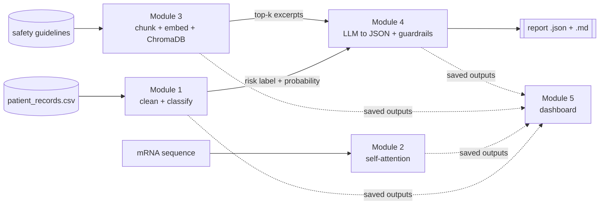
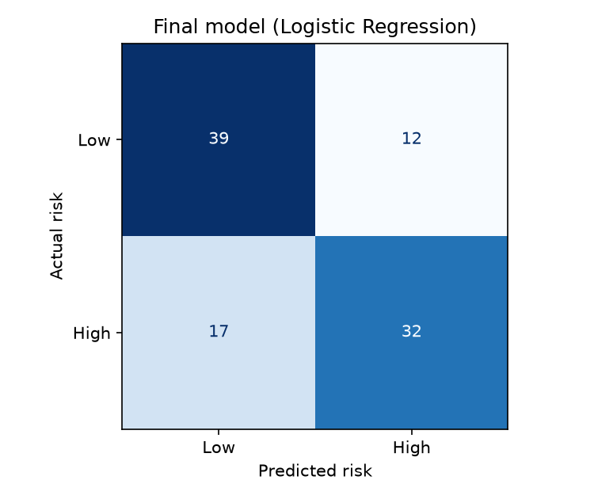
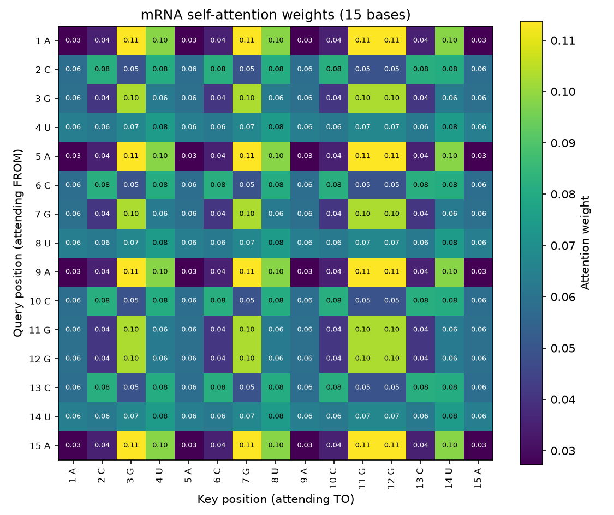
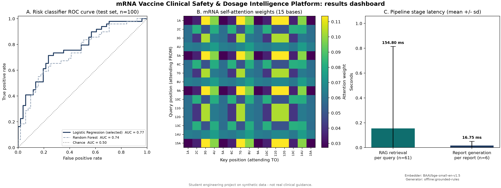

<!-- AUTO-GENERATED by src/writeup.py. Delete this line once you edit the report, so reruns stop overwriting it. -->

# mRNA Vaccine Clinical Safety & Dosage Intelligence Platform: project report

*Generated 22 October 2026 from the files in `outputs/`.*

> **Disclaimer:** student engineering project on synthetic data. Nothing here is real clinical or regulatory guidance. This is a case study that references Moderna's public mRNA work; it is not affiliated with or endorsed by Moderna.

> **Note: these results come from offline fallbacks.** In this run reports were drafted by the offline rule-based generator, not an LLM. Install the full requirements, set an LLM API key in `.env`, run `python main.py all --rebuild`, and this report regenerates with the final numbers.

## 1. Executive summary

This platform takes a patient's age, inflammatory biomarker level, pre-existing conditions, candidate dose and prior reaction history and produces a schema-validated safety report: eligible or not, a recommended dose, step-by-step reasoning, and the exact guideline sentences the decision rests on. Three layers of AI work in sequence. A Logistic Regression classifier predicts adverse-reaction risk (test F1 0.69, ROC-AUC 0.77). A retrieval index over the safety guideline supplies the relevant rules. A language model combines the two into structured JSON, which deterministic guardrails then check against the retrieved dose limits. A from-scratch self-attention module demonstrates the mechanism behind the language model on an mRNA sequence. The project shows how predictive ML, retrieval and generative AI hand off to each other in a regulated setting, with every step validated and every claim traceable to a source.

## 2. Architecture



## 3. Module 1 results: risk classifier

The 500-record dataset had 20 missing biomarker values (4.0%) and 17 missing reaction histories (3.4%). Biomarker gaps were filled with the median and reaction-history gaps with the mode. One data trap was important: pandas reads the text `None` as a missing value by default, which would have turned 291 real "no prior reaction" patients into blanks. The loader treats only empty cells as missing.

| Model | Test F1 (High risk) | Test ROC-AUC | Test accuracy | 5-fold CV F1 (train) | Tuned parameters |
|---|---|---|---|---|---|
| Logistic Regression (selected) | 0.688 | 0.770 | 0.710 | 0.733 | C=0.1 |
| Random Forest | 0.667 | 0.738 | 0.680 | 0.694 | max_depth=8, min_samples_leaf=5 |



**Interpretation.** On the 100 held-out patients the selected Logistic Regression caught 32 of 49 high-risk patients (recall 65%) and 12 of the 51 low-risk patients were flagged unnecessarily. The strongest feature is Biomarker_Level. Feature weights: Biomarker_Level (+0.85), Pre_Existing_Conditions (+0.55), Vaccine_Dose_mcg (+0.51), Prior_Reaction_History (+0.46), Age (+0.33) (coefficients on standardized inputs, except Pre_Existing_Conditions per condition and reaction history per severity step).

**Model comparison.** Logistic Regression reached a test F1 of 0.688 against 0.667 for the Random Forest, and a ROC-AUC of 0.770 against 0.738, so it was selected and saved to `outputs/risk_model.joblib`. The simpler model winning is a sign that the signal in this data is mostly additive: each risk factor pushes the probability up on its own, which is exactly the shape a logistic regression assumes. The Random Forest can model interactions, but with only 400 noisy training rows the extra flexibility mostly fits noise, and its cross-validation F1 was also lower. Both models land in the 0.65-0.80 range the PRD calls believable for this deliberately noisy data; a much higher score would suggest leakage. In a clinical setting recall on the High-risk class matters most, so a lower decision threshold would be worth exploring.

EDA figures: [distributions](../outputs/figures/eda_distributions.png), [correlation heatmap](../outputs/figures/eda_correlation_heatmap.png), [class balance](../outputs/figures/eda_class_balance.png), [risk by prior reaction](../outputs/figures/eda_reaction_history.png).

## 4. Module 2 results: self-attention on an mRNA sequence



Sequence `ACGUACGUACGGCUA` (15 bases), 8-dimensional embeddings, one attention head. Every row of the 15x15 matrix sums to 1.

**What the heatmap shows.** Each base is first turned into an 8-number embedding vector. Three weight matrices then turn every embedding into a query (what this position is looking for), a key (what it offers to others) and a value (the information it passes on). The score between positions i and j is the dot product of query i with key j, divided by the square root of the key size so that scores stay around unit scale. A softmax turns each row of scores into percentages that add up to 100%, and the output for each position is the matching blend of value vectors. In the heatmap, row i shows where position i sends its attention. The strongest pattern is A->G (mean weight 0.114) followed by G->G (0.103), compared with 0.067 if attention were spread evenly; the weakest is A->A (0.027). Rows for the same base are identical, and so are columns, because no positional information is added: the model only knows which base sits at a position, not where it is. The preferences themselves are not biology. The weights were randomly initialized and never trained, so they reflect which random embedding vectors happen to line up after projection. Training on a real task, plus positional encodings (already implemented as an option), would make the pattern meaningful.

Multi-head attention (the bonus task) is implemented in `multi_head_attention()` and tested with 2 and 4 heads.

## 5. Module 3 results: retrieval over the safety guidelines

Embedding model `BAAI/bge-small-en-v1.5`, store `chromadb`, 4 chunks, k = 3. Full tables, including a paraphrase stress test: [`outputs/rag_test_queries.md`](../outputs/rag_test_queries.md).

| Chunk | Tokens | Overlap with previous |
|---|---|---|
| 0 | 357 | 0 |
| 1 | 362 | 64 |
| 2 | 355 | 54 |
| 3 | 314 | 158 |

Top-ranked chunk contains the answering sentence for **4 of 8** standard questions:

| Question | Top chunk covers | Hit@1 | Latency (s) |
|---|---|---|---|
| What are the storage requirements below -20C? | Section 1, Section 2 | **no** | 2.2493 |
| How long can a thawed vial stay in the refrigerator before it must be discarded? | Section 1, Section 2 | **no** | 0.0661 |
| What dose range applies to adults aged 12 to 64? | Section 2, Section 3 | yes | 0.0532 |
| When does a dose need secondary clinician review? | Section 2, Section 3 | **no** | 0.0555 |
| Should dosing be deferred for a patient with an elevated inflammatory biomarker? | Section 2, Section 3 | yes | 0.0639 |
| What are the absolute contraindications for an mRNA product? | Front matter, Section 1 | **no** | 0.0725 |
| How long should patients be monitored after administration? | Section 3, Section 4 | yes | 0.0822 |
| Within how many hours must a moderate adverse event be documented? | Section 3, Section 4 | yes | 0.0582 |

**Chunk size and overlap.** The document is short (about 1,112 tokens), so chunks target about 350 tokens, the lower part of the required 300-500 range. That gives four chunks instead of two or three: with k = 3, a two-chunk index would return the whole document for every query and retrieval would test nothing. Chunks are built from whole sentences so no rule is cut in half, and the last sentences of each chunk (about 50 tokens) are repeated at the start of the next, so a clause near a boundary is complete in at least one chunk. LangChain's splitter enforces only a maximum size, so a custom sentence packer guarantees the 300-token minimum; the final chunk is grown backwards when needed, which is why its overlap is larger. The embedding model is `BAAI/bge-small-en-v1.5` rather than `all-MiniLM-L6-v2` because MiniLM truncates input at 256 word-pieces, which would silently drop the end of every 300-500 token chunk.

**Failure case.** *"What are the storage requirements below -20C?"* The answer ("-25C and -15C") is in Section 1, but the top chunk covered Section 1, Section 2 and the answering chunk was ranked 2. Hypothesis: of the question's content words (20c, below, requirements, storage), none appear in the answering sentence. Even a semantic model compresses a whole 300-500 token chunk into one vector, so a chunk that mostly discusses something else can outrank the chunk holding a single relevant sentence. Smaller chunks or re-ranking the top results would help.

Misses in this run: 4 of 8 standard questions and 0 of 5 paraphrased questions.

## 6. Module 4 results: structured safety report

Reports were generated by `offline:grounded-rules`. Every response is parsed as JSON and validated against the strict `ClinicalSafetyReport` schema, with exactly one retry on failure. A deterministic guardrail layer then checks the dose against the bound parsed from the retrieved text (FR-4.4), applies the secondary-review clauses, removes citations that are not verbatim guideline text, and forces the disclaimer. Guardrails can only make a decision more conservative, never less.

| Patient | Eligible | Dose (mg) | Rules triggered |
|---|---|---|---|
| P0003 | no | 0 | candidate_dose_above_review_threshold |
| P0011 | yes | 0.0347 | none |
| P0013 | no | 0 | age_65_plus_with_2_conditions |
| P0032 | no | 0 | prior_moderate_reaction;elevated_biomarker |
| P0116 | yes | 0.05 | none |
| SAMPLE-58Y-120MCG | no | 0 | candidate_dose_above_review_threshold |

Full sample (`outputs/reports/P0116_report.json`):

```json
{
  "Eligible_For_Vaccine": true,
  "Recommended_Dose_mg": 0.05,
  "Reasoning_Steps": [
    "The Module 1 risk model predicts High reaction risk (probability 0.74).",
    "The candidate dose of 64.5 mcg is within the 25-100 mcg reference range in the retrieved guideline.",
    "Because predicted risk is High, the dose is lowered to 50 mcg, the top of the 25-50 mcg lower-reactogenicity band in the guideline.",
    "Post-administration monitoring applies as stated in the retrieved guideline."
  ],
  "FDA_Safety_Warnings_Cited": [
    "As a general reference range across mRNA vaccine platforms, primary-series doses commonly fall between 25 and 100 micrograms, while booster or lower-reactogenicity formulations are frequently dosed between 25 and 50 micrograms.",
    "Patients should be monitored for at least 15 minutes following administration, or 30 minutes for patients with a documented history of any allergic reaction."
  ],
  "Disclaimer": "Student engineering project output - not real clinical guidance. Do not use for medical decisions."
}
```

How each reasoning step is grounded:

| Step | Source |
|---|---|
| 1 | Module 1 risk output |
| 2 | retrieved guideline excerpt (Module 3), cited below |
| 3 | retrieved guideline excerpt (Module 3), cited below |
| 4 | retrieved guideline excerpt (Module 3), cited below |

Each entry in `FDA_Safety_Warnings_Cited` was checked to appear word for word in the retrieved chunks. `Recommended_Dose_mg` is 0.05 mg = 50 mcg (the PRD's field is in milligrams while the data uses micrograms).

## 7. Dashboard



Panel A: the classifier separates risk classes well above chance. Panel B: the attention pattern from Module 2. Panel C: average time per retrieval query versus per generated report; with a hosted LLM, generation dominates end-to-end latency.

## 8. Limitations and future work

1. **Small, synthetic dataset.** 500 rows and 5 features cap the classifier near 0.7 F1, and with a 100-row test set one patient moves F1 by about 1%. With more time: repeated cross-validation for tighter estimates, probability calibration, and choosing the decision threshold for high recall on the High-risk class.
2. **Retrieval granularity.** With 4 chunks and k = 3 the retriever returns most of the document, so precision@1 is the only meaningful metric, and chunk vectors dilute single-sentence rules. Sentence-level indexing with a cross-encoder re-ranker, or hybrid BM25 + dense search, would sharpen it.
3. **Rules are partly hand-coded.** Guardrail rules are linked to guideline clauses by regex, and the biomarker threshold (10 mg/L) is a project assumption because the guideline gives no number. A real system would take thresholds from a versioned clinical rules source signed off by clinicians.
4. **LLM cost and latency.** Each report is one or two LLM calls (seconds each, see the dashboard), so a batch of thousands of patients would be slow and paid. Caching retrieval per patient profile and using the offline generator for clear-cut cases would cut both.
5. **Attention module is untrained.** It demonstrates the mechanism, but its weights are random, so the heatmap carries no biological meaning. Training it on a sequence task (for example predicting masked bases) would be the next step.

## 9. Reproduction instructions

```bash
python -m venv venv
venv\Scripts\activate            # Windows   (macOS/Linux: source venv/bin/activate)
pip install -r requirements.txt
copy .env.example .env            # then add ANTHROPIC_API_KEY or OPENAI_API_KEY (optional)
python main.py all --rebuild      # runs Modules 1-5 and regenerates this report
python -m unittest discover -s tests -v
```

Individual steps: `python main.py data | train | attention | index | report | dashboard | writeup`.
